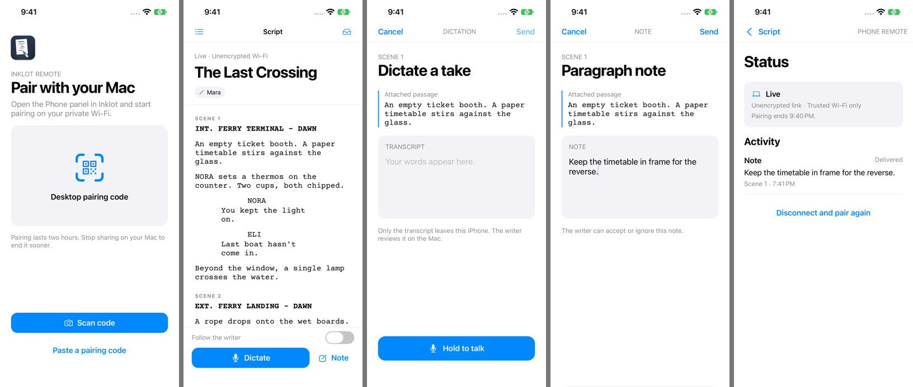
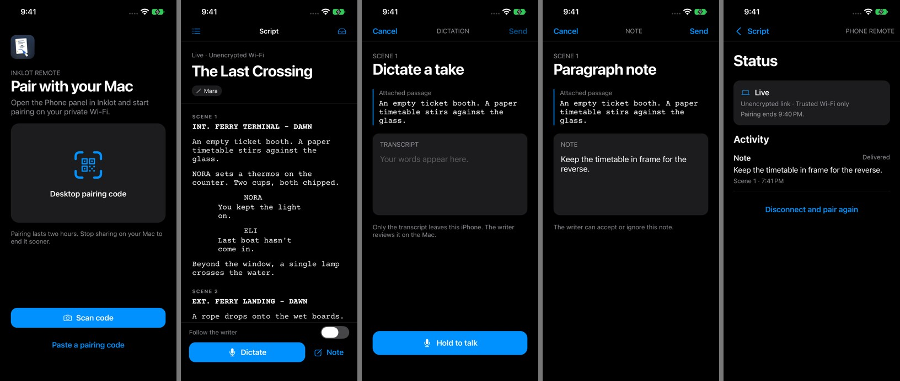

# Cold Open Remote on iPhone

An iPhone 17e simulator connected to the desktop relay and phone server. The screenplay
is synthetic. The note in Status was sent through the inbox API. The dictation screen
shows the state before recording.

| Screen | Light | Dark |
| --- | --- | --- |
| Pair with your Mac | [Full size](pairing-light.png) | [Full size](pairing-dark.png) |
| Live script | [Full size](script-light.png) | [Full size](script-dark.png) |
| Dictate a take | [Full size](dictate-light.png) | [Full size](dictate-dark.png) |
| Paragraph note | [Full size](notes-light.png) | [Full size](notes-dark.png) |
| Status and receipts | [Full size](status-light.png) | [Full size](status-dark.png) |

The simulator also restored the pairing and a pending note after the app was terminated.
When the host resumed, the pending note became delivered. The release build also paired
over the Mac’s selected LAN address using the code decoded from the Electron panel’s
rendered QR. Long-pressing a passage and accepting the note in Electron changed its
receipt to Accepted. Stop changed the phone state to Host stopped sharing.

Physical camera scanning,
microphone recognition with a locally installed language, VoiceOver gestures on hardware,
and certificate trust on a real iPhone remain device checks.

## Production changes and scene suggestions

The iPhone’s Changes view shows revision sets and colors, marked text and deletions,
omitted scenes, A-scenes, locked pages and changed breakdown tags. Tap a scene to
return to its heading. Text and tag comparisons use the first publication in the
current document session and revision set as their baseline. Reopening the document
or changing the active revision set starts a new baseline. Existing revision marks,
A-scenes, omissions and page locks remain visible without a comparison baseline.

Write and Dictate offer Save as take and Send to script. Send to script captures the
Mac’s current scene heading, or requests the end of the script. The Mac formats the
text with the dictation formatter and shows a scene suggestion in the Phone inbox.
Accept scene inserts it in one undoable edit. Discard returns an Ignored receipt.
If the captured scene is removed or its heading changes, the Mac refuses insertion.

The existing pairing and take formats remain supported. Production metadata is an
optional `production` object with `v: 2` in desktop awareness and HTTP snapshots.
Snapshots also carry paragraphs for the iCloud reader. The Mac atomically publishes
`Inklot Phone Inbox/<deviceId>/production.json` for remembered iPhones. The iPhone
reads it through its granted native folder access when the live link is unavailable,
and caches the last production summary with its reader.

Scene suggestions use inbox kinds `scene-after` and `scene-end`, with the scene
heading ID and source text in the existing anchor fields. New HTTP and folder
messages carry `v: 2`; folder messages for existing take kinds retain `v: 1`.
The HMAC domain and field order remain `inklot-take-v1`, device ID, script ID,
receipt ID, kind, text, paragraph ID, source text. One-off HTTP pairings sign with
empty device/script IDs. The destination is covered by both HMAC and content hash
because it is part of the kind. New Macs still accept existing phone messages;
older Macs reject the new suggestion kinds. AirDrop batches keep their existing
version and authenticate each item using the same signed fields.
